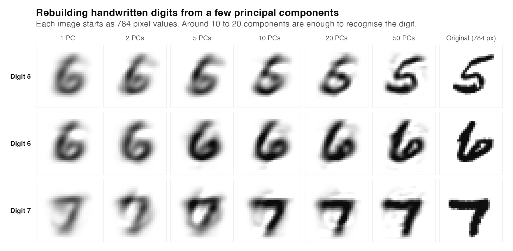
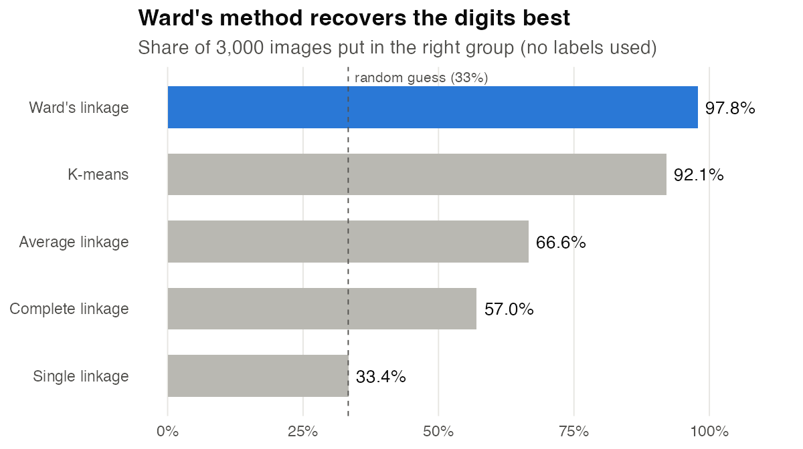
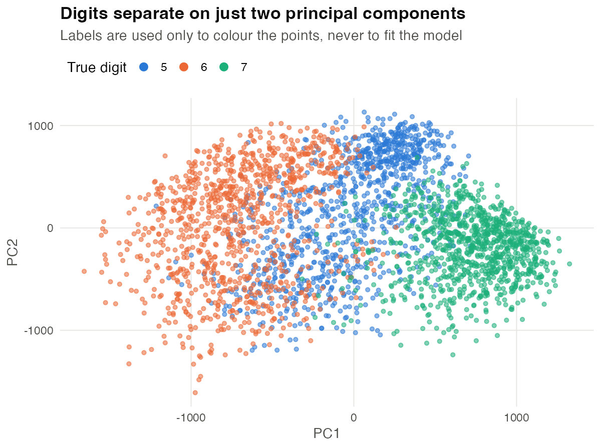
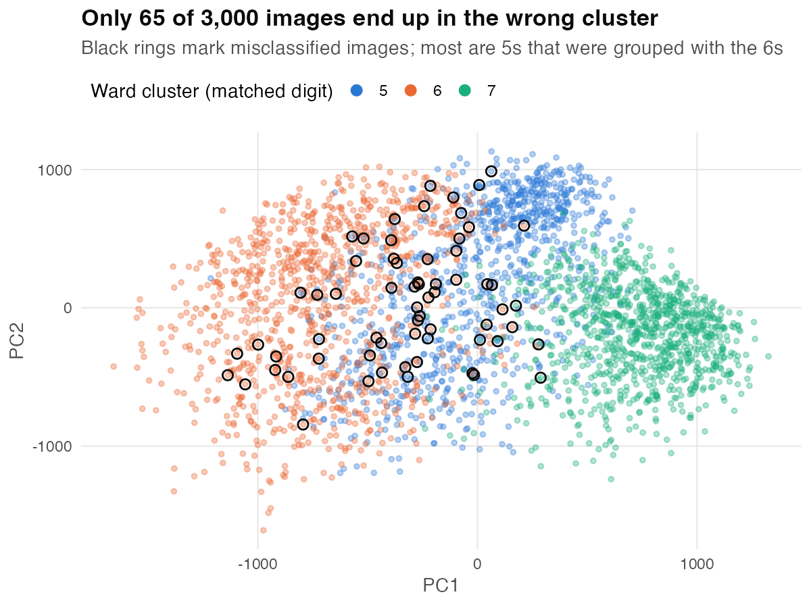

# Unsupervised Digit Clustering

**Can a model sort handwritten digits without ever being told which is which? Yes: 97.8% of 3,000 images end up in the right group, using PCA and Ward's hierarchical clustering with no labels.**

Coursework for *Multivariate Statistics and Machine Learning*, University of Manchester, 2025/26. Done in R, then rebuilt in Python with scikit-learn.

**[▶ Read the interactive report](https://raudhahabas.github.io/unsupervised-digit-clustering/)** (opens in the browser, no download)
· [PDF version](report/digit_unsupervised_learning.pdf)
· [Python notebook](notebooks/digit_clustering_python.ipynb)



---

## The problem

The dataset has 3,000 grayscale images of handwritten **5s, 6s and 7s** (1,000 of each). Each image is 28 × 28 pixels, so every digit is a point in **784-dimensional space**.

The task is **unsupervised**. The models never see the labels. They have to find the three groups from the pixels alone. The labels are used only at the end, to check how well the groups match the real digits.

This is the same kind of problem as segmenting customers or grouping documents when nobody has labelled the data.

## Approach

| Step | What I did | Why |
|---|---|---|
| **1. Reduce** | PCA: 784 pixels → 20 principal components | Removes noise and redundancy. 20 components keep 68% of the variance, and distances become meaningful for clustering |
| **2. Cluster** | K-means (25 random starts) and hierarchical clustering with 4 linkages: single, complete, average, Ward | Compare a centroid method against tree-based methods that define "closeness" in different ways |
| **3. Score** | Match each cluster to its best digit, then count mistakes | Cluster numbers are arbitrary (cluster 1 isn't necessarily the 5s), so they must be matched before scoring |
| **4. Reconstruct** | Invert PCA, $\hat{X} = T_K U_K^\top + \mu$, for K = 1 … 50 | Shows what the compressed features actually keep |

## Results



| Method | Correctly grouped | Misclassified (of 3,000) |
|---|---:|---:|
| **Ward's linkage** | **97.8%** | **65** |
| K-means | 92.1% | 238 |
| Average linkage | 66.6% | 1,002 |
| Complete linkage | 57.0% | 1,289 |
| Single linkage | 33.4% | 1,998 |

What the results show:

- **Ward's method works best because it matches PCA.** Ward merges clusters so as to keep the variance inside each cluster small, and PCA is built around variance too. Together they give compact, well-separated groups.
- **Single linkage fails completely.** It "chains" points together and puts nearly every image in one giant cluster. Its 33% is no better than guessing.
- **Most mistakes are 5s.** Of Ward's 65 errors, 46 are 5s that were grouped with the 6s. A 5 with a closed lower loop looks a lot like a 6. The 6s and 7s are almost perfect (988 and 996 of 1,000).
- **Two components already separate the digits.** The 7s sit clearly apart on the first two principal components. The 5s overlap with the 6s, which is where the errors come from.

<table>
<tr>
<td></td>
<td></td>
</tr>
</table>

**Compression.** With 10 to 20 components (about 2% of the original 784 numbers), every digit is easy to read. With 50, most of the fine detail returns (see the image at the top).

**Python check.** The scikit-learn notebook reaches the same conclusion: Ward 98.4%, K-means 92.1%. The small differences in the weaker linkages come from how R and scikit-learn break ties when merging clusters.

## Skills this project shows

- **Dimensionality reduction:** PCA from first principles (eigen-decomposition, scree analysis, inverse transform and reconstruction)
- **Unsupervised learning:** K-means and four hierarchical linkages, compared fairly on the same features
- **Evaluation:** cluster-to-label matching (all permutations in R, the Hungarian algorithm in Python), confusion matrices, adjusted Rand index
- **Communication:** a written report that explains *why* each method behaves as it does, plus clear visuals
- **Tools:** R (base, ggplot2, R Markdown) and Python (NumPy, pandas, scikit-learn, SciPy, matplotlib)

## Run it yourself

**R** (report and figures):

```bash
git clone https://github.com/raudhahabas/unsupervised-digit-clustering.git
cd unsupervised-digit-clustering
Rscript scripts/make_figures.R
Rscript -e 'rmarkdown::render("report/digit_unsupervised_learning.Rmd", output_format = "all")'
```

**Python** (notebook):

```bash
python -m venv .venv && source .venv/bin/activate
pip install -r requirements.txt
jupyter notebook notebooks/digit_clustering_python.ipynb
```

## Repository layout

```
data/digit.txt                      3,000 images: label + 784 pixel values per row
report/
  digit_unsupervised_learning.Rmd   full analysis in R Markdown
  digit_unsupervised_learning.pdf   rendered report
notebooks/
  digit_clustering_python.ipynb     the same analysis in scikit-learn
scripts/make_figures.R              builds every chart in figures/
figures/                            charts used in this README
docs/index.html                     HTML report (GitHub Pages)
```

## Author

**Siti Raudhah Abas** · BSc Mathematics, University of Manchester
